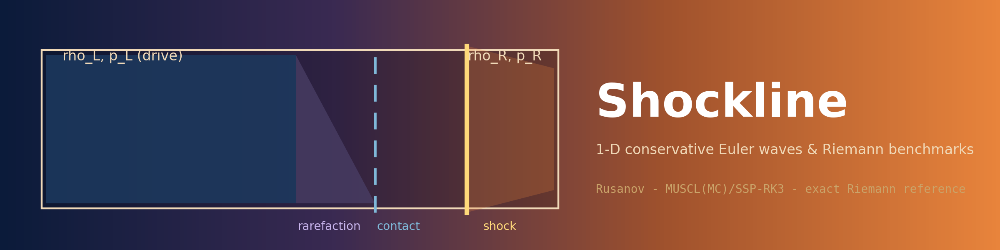
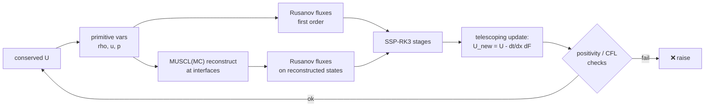

<div align="center">



# ⚡ Shockline

### 1-D conservative Euler waves & Riemann benchmarks

**An original 1D finite-volume solver — first-order Rusanov and second-order
MUSCL(MC)/SSP-RK3 — verified against an exact Newton-iteration Riemann solver, with
convergence orders 1 and 2 measured against an exact advected-contact reference.**

[](https://github.com/khalil-work/shockline-euler/actions/workflows/ci.yml)
[](LICENSE)
[](requirements.txt)
[](tests)
[](docs/verification.md)
[](https://github.com/khalil-work/shockline-euler/stargazers)
[](https://github.com/khalil-work/shockline-euler/commits)

[Quick start](#-quick-start) · [Method](#-model-method-and-stability) · [Animation](#%EF%B8%8F-results-gallery) · [Metrics](#-results-and-metrics-nondimensional) · [References](#-references)

</div>

---

## 🎯 Purpose and scope

A compact, conservative 1D Euler solver with two accuracy levels and its own exact
Riemann reference, written for learning and **verification-first shock capturing**.

> **Scope:** one dimension, ideal gas (γ-law), uniform grids, short enough times that
> waves stay inside the domain. Not multi-dimensional, not viscous, not reacting, and
> no strong-shock or vacuum capability claims.

| | |
| --- | --- |
| 🧮 **State** | conserved U = (ρ, ρu, E), finite-volume telescoping update |
| 1️⃣ **First order** | Rusanov flux — positivity preserving under dt < Δx/max(\|u\|+c) |
| 2️⃣ **Second order** | MUSCL reconstruction of primitive variables, MC limiter + SSP-RK3, CFL 0.40 |
| 🎯 **Reference** | exact Riemann solver (Toro ch. 4), Newton iteration on the star pressure |
| 📏 **Measured** | convergence orders 1 and 2 against an exact advected-contact reference |

## 🧮 Model, method, and stability

- Rusanov flux F̂ = ½(F_L+F_R) − ½·s_max·(U_R−U_L), s_max the larger signal speed.
- MUSCL reconstruction of **primitive** variables with the MC limiter (no new extrema
  at interfaces) + three-stage SSP-RK3.
- Exact Riemann solver raises clear errors for non-finite/vacuum inputs and
  non-convergence.
- Boundaries: zero-gradient (outflow) ghosts — an extrapolation rule, not a
  guaranteed non-reflecting condition; benchmarks keep waves inside.
- All benchmark quantities are **nondimensional** (standard Sod convention).

Full derivation: [docs/model.md](docs/model.md); API with parameters and error
behavior: [docs/api.md](docs/api.md).

### One finite-volume step



## ⚡ Quick start

```bash
python -m pip install -r requirements-dev.txt
python -m pytest tests -q                       # 12 verification tests
python examples/run_verification.py             # figures + GIF + raw data
```

Verified runtimes: Python 3.13.5, NumPy 2.1.3, Windows 11; CI runs the suite on
Ubuntu. The independent clean-environment run passed 12 tests in 29.6 s on this
Windows machine; the recorded results script took about 62 s.

<details>
<summary><b>🧱 Architecture & API example</b></summary>

```
finite_volume/
└── euler1d.py        # transforms, Rusanov flux, step_rusanov,
                      # step_muscl_ssp3, integrate, exact Riemann solver
tests/test_euler1d.py # 12 verification tests
examples/run_verification.py
docs/ model.md  api.md  verification.md  results/
```

```python
import numpy as np
from finite_volume import conserved, integrate, primitive, sod_initial

n = 400
dx = 1.0 / n
x = (np.arange(n) + 0.5) / n
U0 = conserved(*sod_initial(x), gamma=1.4)
rho, u, p = primitive(integrate(U0, t_end=0.2, dx=dx, gamma=1.4, order=2), 1.4)
```

</details>

## ✅ Verification

Twelve tests: hand-computed Rusanov flux (catches doubled dissipation), freestream
consistency, conservation with equal boundary fluxes, the
momentum-vs-pressure-force integral, positivity (first order), published Sod star
state, analytic rarefaction-fan profile, exact-reference convergence orders, limiter
monotonicity, and input/failure handling. Evidence and limits:
[docs/verification.md](docs/verification.md).

> **Not established:** strong shocks, other γ, vacuum, non-reflecting boundaries.

## ⚠️ Limitations and next steps

- 1D, uniform grid, ideal gas; no sources, viscosity, or reactions.
- Zero-gradient boundaries can reflect subsonic characteristics — respect the
  wave-inside-domain time limit of each benchmark.
- Second-order positivity is monitored (stage checks raise on failure) and
  CFL-managed, not unconditionally proven.
- Natural next steps: HLLC flux option, transmissive boundary study,
  grid-refinement shock-position convergence.

---

## 🎞️ Results gallery

<div align="center">

**▶ Watch the computed shock tube evolve:**


<sub>41 frames recorded from the computed second-order run (N = 400,
nondimensional Sod states) by <code>examples/run_verification.py</code>; the
dashed line is the exact Riemann solution at each instant. No smoothing or
interpolation between frames.</sub>

</div>

### 📈 Results and metrics (nondimensional)

| Case | Metric | First order | MUSCL-SSP3 |
| --- | --- | --- | --- |
| Sod, N=400, t=0.2 (nondimensional, vs exact Riemann) | L1(ρ) | 1.10e-2 | **1.85e-3** |
| Exact star state (published: p\*=0.30313, u\*=0.92745) | error | — | < 5e-5 |
| Advected contact convergence (N=100→800) | observed order | 0.86→0.96 | **2.21→2.02** |
| Momentum balance vs boundary-flux integral (p_L−p_R)·t | error | — | < 1e-10 rel |

### 🖼️ Static figures & raw data

- [sod_comparison.png](docs/results/sod_comparison.png) — Sod tube vs exact
  Riemann solution (cover)
- [contact_convergence.png](docs/results/contact_convergence.png) — convergence
  study
- Raw data: [docs/results/](docs/results) — `sod_history.csv`,
  `contact_convergence.csv`, `run_summary.json`; animation `sod_evolution.gif`

## 📚 References

- E. F. Toro, *Riemann Solvers and Numerical Methods for Fluid Dynamics*
  (exact Riemann solver, MUSCL, SSP-RK).
- R. J. LeVeque, *Finite Volume Methods for Hyperbolic Problems*
  (conservation, limiters).
- G. A. Sod, "A survey of several finite difference methods for systems of
  nonlinear hyperbolic conservation laws" (J. Comput. Phys., 1978) — the benchmark.

Dependencies: NumPy (BSD-3), Matplotlib (PSF-based), Pillow (HPND),
pytest (MIT). This repository's own code is original and MIT-licensed; see
[LICENSE](LICENSE).

---

Calendar metadata: [reconstructed date records](docs/CALENDAR_HISTORY.md) were
generated on 18 October 2026. Their historical author dates are synthetic; they do
not date the software development. Original source commits and actual committer
dates are preserved.
